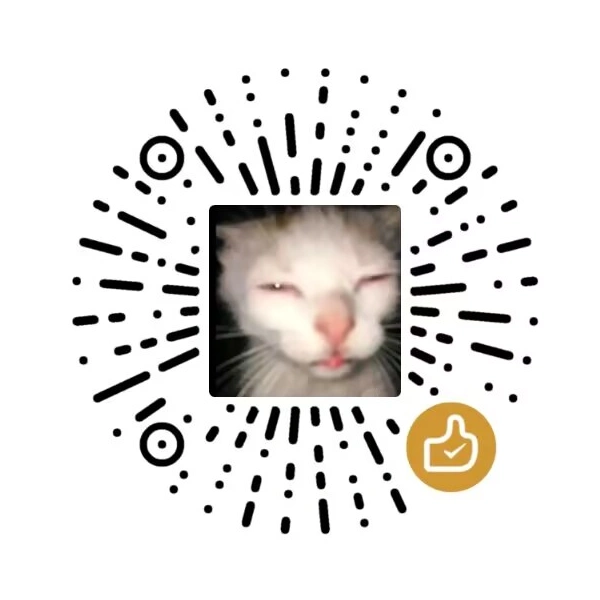

# IdleLegions自动下井

免费的 Idle Legions 自动下井工具，提供中文网页控制台、本地推演、冻结构筑和循环下潜。适用于 Windows 10 / 11 64 位与 Steam 版 Idle Legions。

**该软件免费并开源，如果是付费购买请前往退款**

开源地址: https://github.com/weixiao030/IdleLegions-AutoAbyss

## 下载与使用

发行包名称为 `IdleLegions-AutoAbyss-v1.3.0-win-x64.zip`，解压后双击 **IdleLegions自动下井.exe**。发行包自带 .NET 运行环境，无需安装 Node.js、Python 或 .NET。

1. 正常关闭游戏，在网页的「连接设置」安装桥接。
2. 启动游戏并登录，等待显示「游戏已连接」。未自动找到游戏时，填写 `client.exe` 的完整路径，自动保存。
3. 按需设置参数，选择单次下潜、循环指定次数或循环到绳索用完。

在「策略参数 → 职业与站位」自由选择全部 8 个中文职业，前排、后排各两个位置。默认从前到后为狂战士、法师、弓箭手、圣骑士；选择已上阵职业会交换位置，也可前移、后移。修改即自动保存，重开后保留，下一次入场生效。

默认优先传说普攻冻结加五次弹跳，其次普通冻结核心；可叠加多个高级可继承开局盾，再补减速、减速增伤、异常增伤和弹跳，双暴作为补充；前 7 层有冻结效果时偏向核心与碎屑奖励。默认持续下潜到最深或战败，禁止撤离。完整配置与恢复方式见 [使用说明](docs/使用说明.md)。

关闭网页后程序仍在系统托盘运行，可从托盘打开控制台、暂停或退出。

## 免费与赞赏

连接设置中可查看、放大和保存作者赞赏码。

**无论是否打赏都不影响使用，全部免费,感谢板板支持**



## 从源码构建

需要 Windows、.NET 8 SDK、Node.js 22 和 Python 3。前端使用 React、官方 Radix Themes 和 Phosphor Icons。

```powershell
./build.ps1
python tools/package_release.py
```

EXE 位于 `release/IdleLegions自动下井.exe`，发行 ZIP 和 SHA-256 清单位于 `artifacts/`。`build.ps1` 会安装锁定的 npm 依赖、构建前端并将前端及桥接嵌入自包含 EXE。

运行已有策略自测：

```powershell
$test = Start-Process -FilePath './release/IdleLegions自动下井.exe' -ArgumentList '--self-test' -Wait -PassThru
if ($test.ExitCode -ne 0) { throw '自测失败' }
Get-Content "$env:LOCALAPPDATA/FrostAbyss/self-test.json"
```

为兼容已有用户，参数及桥接仍保存在原来的 `FrostAbyss` / `frost_abyss` 目录。

## 测试与边界

1.3 取消策略数值的人为上下限并改为自动保存；普攻点燃、普攻带电硬禁，高级护盾可叠加，验证见 [1.3 发布验证](docs/发布验证-1.3.md)。默认间隔1000ms，已有配置保留原值。电伤清除冻结仍为模型假设，不能作为已确认的游戏结论。

1.2 系列首次正式发布为 1.2.1，修复了干净构建的依赖锁文件；1.2 新增全部 22 种精英多选软避让、健康时优先磨利及冰毒异常构筑，修复魂力不足事件卡住，并统一 EXE、托盘和网页图标，见 [1.2 发布验证](docs/发布验证-1.2.md)。默认阵容仍为前排狂战士、法师；后排弓箭手、圣骑士。1.1 新增自由职业与站位，验证见 [1.1 发布验证](docs/发布验证-1.1.md)。1.0 更新包括品牌更名、免费开源说明与赞赏区，见 [1.0 发布验证](docs/发布验证-1.0.md)。下潜策略沿用 0.4.3，旧版真实下潜结果见 [0.4.3 历史实测报告](docs/历史实测报告-v0.4.3.md)。

胜率是本地模型的估计，实际战斗与资源消耗以游戏结算为准。模型并非完整服务端引擎，已知边界见 [模型说明](docs/模型说明.md)。

## 开源许可

项目使用 [Apache License 2.0](LICENSE)，第三方组件见 [第三方组件说明](docs/第三方组件.txt)。游戏商标和内容归其权利人所有。
